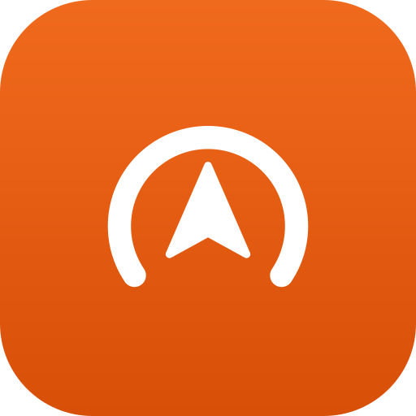
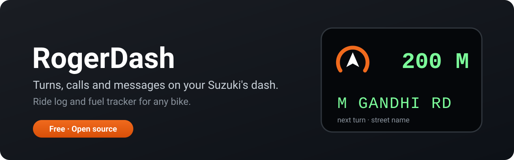

<div align="center">

<br/>



# RogerDash

### Turns, calls and messages on your Suzuki's dash

<br/>

[](https://github.com/rooo1/RogerDash/releases)
[](LICENSE)
[](https://github.com/rooo1/RogerDash/releases)
[](#download)

<br/>

[**Download**](#download) · [**Features**](#features) · [**Bikes**](#bikes) · [**Setup**](#setup) · [**Google search**](#google) · [**Help test**](#help-test) · [**Developers**](#developers)

</div>

> [!IMPORTANT]
> RogerDash is not affiliated with or endorsed by Suzuki. It replaces Suzuki Ride Connect. Only one app can talk to the dash at a time, so close Ride Connect while you use RogerDash.

---

<div align="center">



<h1><a id="features"></a>Features</h1>

**No account, no server, no ads.** Everything stays on your phone.

</div>

<table>
  <tr>
    <td width="50%" valign="top">

#### 🏍️ On the dash (Suzuki)
- **Turn-by-turn arrows** and distance to the next turn.
- **Incoming and missed calls**, with the caller's name.
- **SMS and WhatsApp**: who it's from, never the text.
- **Short pop-ups**: range left, street names, speed warning.

#### 🧭 Navigation
- **Two-wheeler routes**, plus a **weekend-loop planner**.
- **Spoken turns** in your helmet or earphones.
- **Free OpenStreetMap** search and routes out of the box.
- **Offline maps**: save the map around you or along a route for rides without signal.
- **Google search and live traffic** with your own key (optional).

    </td>
    <td width="50%" valign="top">

#### 📱 On the phone (any bike or scooter)
- **Rides recorded automatically**, with a map coloured by speed.
- **Fuel log** with your real mileage.
- **Range estimate** from fuel bars and your mileage.

#### ⚙️ Setup & your data
- **Setup wizard** that tests your phone and dash.
- **Backup and restore** of rides, fill-ups and settings in one file.
- **Private**: caller and sender names only go to the dash and are never stored.

    </td>
  </tr>
</table>

---

<div align="center">

<h1><a id="bikes"></a>Which bikes it works with</h1>

| Vehicle | Status |
|:---|:---|
| Suzuki **V-Strom 250 SX** | ✅ Tested on a real bike |
| Other Suzukis with a Bluetooth (Ride Connect) dash | ⚠️ **Not tested yet.** Uses the same messages as Suzuki's app, so it should work |
| Older Access / Burgman Street dashes (Bluetooth name starts with `SAS`) | ❌ Not supported yet |
| Any other bike or scooter | ✅ Ride log and fuel tracker (no dash features) |

</div>

---

<div align="center">

<h1><a id="download"></a>Download</h1>

<a href="https://github.com/rooo1/RogerDash/releases/latest"></a>

Get `RogerDash-<version>-release.apk` from [**Releases**](https://github.com/rooo1/RogerDash/releases/latest) and open it on your phone (Android 12 or newer).<br/>
Android will ask you to allow **"Install unknown apps"** for your browser or file manager.

</div>

> [!TIP]
> **"Restricted setting" when allowing notification access?** Android does this for apps installed from a file. Open App info → ⋮ → *Allow restricted settings*, then try again.

---

<div align="center">

<h1><a id="setup"></a>Setup</h1>

</div>

The **setup wizard** starts by itself. It asks what you ride and for the permissions your setup needs, then tests everything on your phone and bike:

1. 🔗 The connection to your dash, plus a test turn arrow and pop-up
2. 📞 A test call and message on the dash
3. 🎧 Spoken turns in your helmet
4. ⛽ Your tank size and mileage

At the end you get a **report** of what works and what to fix. You can run the wizard again any time from **More → How it works**.

---

<div align="center">

<h1><a id="google"></a>Better search with Google <sub>(optional)</sub></h1>

</div>

Out of the box, search and routes use OpenStreetMap, which is free but misses some newer places. With **your own** Google key you get Google search, two-wheeler routes with live traffic, and petrol pumps along your route.

**More → Google Maps** walks you through it, with Copy buttons for everything:

1. In [Google Cloud Console](https://console.cloud.google.com/google/maps-apis/credentials), create a project (Google asks for a billing account).
2. Enable **Places API (New)** and **Routes API**.
3. Create an API key restricted to **Android apps**: package `app.roger.dash` and the SHA-1 shown in the app. For the official release it's<br/>`D5:A2:11:B0:B7:EA:5F:4D:94:14:CC:57:63:FA:4D:D1:23:E7:40:7D`
4. Paste the key in the app and tap **Save key**. The app checks it straight away.

Your key stays on your phone, and Google bills your own account. If Google refuses the key, the app says why and falls back to OpenStreetMap.

---

<div align="center">

<h1>Good to know</h1>

</div>

- **Pop-ups are short.** The V-Strom dash shows 12 capital letters, so street names are shortened ("Mahatma Gandhi Road" → "M GANDHI RD").
- **Range is an estimate.** Fuel bars × your mileage, counted down by the km you ride. When a bar goes out, the app knows the fuel is at the top of the next bar. Log full-tank fill-ups and it gets more accurate.
- **Offline maps** (More → Offline maps, or the route preview) keep the map and a route you already planned working without signal. Search and new routes still need signal. A city is usually 10–40 MB.
- **The bike doesn't send its trip average** (V-Strom), so type in the AVG from your dash, or log fill-ups.
- **Moving to a new phone?** More → Backup saves everything to one file. It includes your Google key if you entered one, so keep it private.

---

<div align="center">

<h1><a id="help-test"></a>Help test your Suzuki</h1>

Ride a Suzuki that isn't ✅ above? The setup wizard tests the dash on your bike and writes the results to the app's log<br/>(**More → Dash test tools → Log**).

[**Open an issue**](https://github.com/rooo1/RogerDash/issues/new) with the log, your model and year, and your bike gets added to the list.

</div>

---

<h1 align="center"><a id="developers"></a>For developers</h1>

<details>
<summary><b>Build</b></summary>

<br/>

Needs Android SDK 35 and JDK 17.

```powershell
.\gradlew.bat :app:testDebugUnitTest :app:assembleDebug
adb install -r app\build\outputs\apk\debug\RogerDash-<version>-debug.apk
```

</details>

<details>
<summary><b>Release build</b></summary>

<br/>

Releases are signed with the RogerDash key, which is kept outside the repo. Put a git-ignored `keystore.properties` in the project root:

```properties
storeFile=C:/path/to/rogerdash-release.jks
storePassword=...
keyAlias=rogerdash
keyPassword=...
```

```powershell
.\gradlew.bat :app:assembleRelease   # app\build\outputs\apk\release\RogerDash-<version>-release.apk
.\gradlew.bat :app:bundleRelease     # .aab, for the Play Store if needed later
```

Before each release, raise `versionCode` by 1 and update `versionName` in `app/build.gradle.kts`. Always sign with the same key, or phones won't install the update.

</details>

<details>
<summary><b>Google's map in your own build</b></summary>

<br/>

The public release always shows the free OpenStreetMap map. Google's map (Maps SDK for Android) needs a key **inside the APK**, so it's only for builds you make for yourself. Put your key in `local.properties` (git-ignored):

```
MAPS_API_KEY=your-key
```

- **Debug builds** use it automatically.
- **`.\gradlew.bat :app:assembleRelease -Ppersonal`** makes a signed `RogerDash-<version>-personal-release.apk` with Google's map, for your own phone. **Never publish it**: the key can be pulled out of it.

</details>

<details>
<summary><b>Project layout</b></summary>

<br/>

| File | What it does |
|---|---|
| `DashHub.kt` | The app's core: bike connection, rides, navigation, settings |
| `Models.kt` | Supported vehicles, and everything that differs between them |
| `DashLink.kt`, `Frames.kt` | Bluetooth link and the dash's 30-byte messages |
| `PhoneAlerts.kt`, `NavListener.kt` | Calls and messages to the dash |
| `SetupActivity.kt`, `HelpView.kt` | Setup wizard and "How it works" |
| `Router.kt`, `GoogleRoutes.kt`, `Places.kt` | Routes and search (OpenStreetMap or Google) |
| `RouteMap.kt` | The map (OpenStreetMap, or Google in your own builds) |
| `OfflineMaps.kt` | Saved map areas (MBTiles, within OpenFreeMap's download limits) |
| `RideRecorder.kt`, `Trips.kt`, `Range.kt` | Rides, storage, fuel range |
| `Backup.kt` | Backup and restore |
| `*Tab.kt` | The screens: Ride, Navigate, Trips, Fuel, More |

All under `app/src/main/java/app/roger/dash/`.

</details>

Contributions are welcome: open an [issue](https://github.com/rooo1/RogerDash/issues) or a pull request.

---

<div align="center">

<h1><a id="privacy"></a>Privacy</h1>

No account and no server. Rides, fill-ups and settings stay on your phone.<br/>
Searches and routes go to OpenStreetMap services, or to Google if you add your own key.<br/>
Caller and sender names only go to your dash; they're never stored.

</div>

---

<div align="center">

<h1><a id="license"></a>License</h1>

Copyright 2026 the RogerDash authors. Licensed under the [**Apache License 2.0**](LICENSE).<br/>
You can use, change and share RogerDash, including in your own apps, as long as you keep the copyright and licence notices.

<br/>

<sub>The dashboard protocol was worked out from the official app's own messages, for interoperability. Use at your own risk, and don't use your phone while riding.</sub>

</div>
